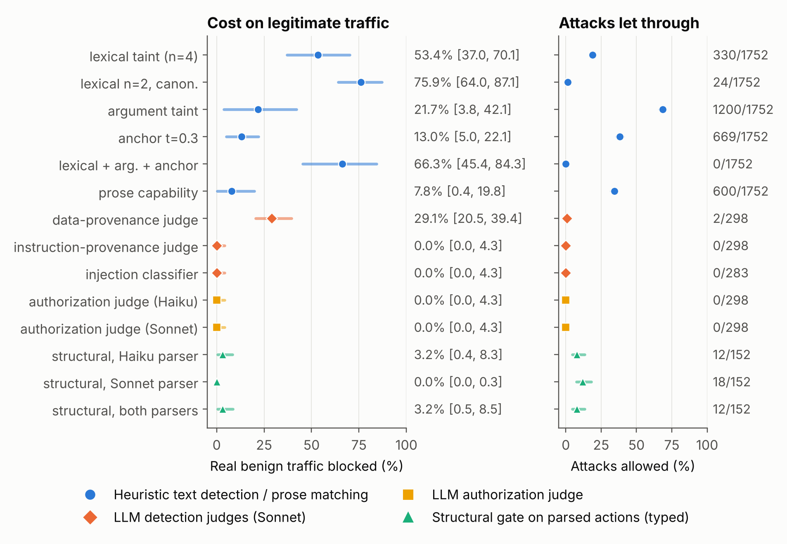

# PivotBench

[](https://github.com/yagna-1/pivotbench/actions/workflows/ci.yml)
[](LICENSE)


**Which boundary checks stop cross-protocol prompt injection between MCP and A2A without blocking legitimate work?** PivotBench is an executable benchmark for that question, and the paper reports a measured answer.

> **Protocol pivoting.** Untrusted content enters through one agent protocol (an MCP tool result or an A2A peer message), crosses a protocol boundary, and is acted on with privileges reachable only through the other protocol. Each protocol's security model assumes it operates alone; PivotBench measures what happens when they don't.

📄 **Paper:** [`paper/PivotBench.pdf`](paper/PivotBench.pdf) (v0.6, 29 pages). Every number in it is reproducible from this repository.



## Findings

"Real traffic" below means messages that models actually wrote inside PivotBench's controlled mock environment: 4,845 benign delegations and 398 compromised payloads from eight models in six families. It is not traffic collected from deployed systems.

1. **Heuristic provenance detection fails on real traffic.** The only text-level gates that keep simulated attack success below 5% block **66–76%** of real benign Claude delegations, because legitimate delegations carry data from the documents they were asked about. On traffic from other model families, the same gates also miss 22–24% of real attacks.
2. **The question a check asks matters more than the model that asks it.** LLM judges asked about *data* provenance block 10–74% of real benign messages. Judges asked about *instruction* provenance, injection presence or *authorization* make almost no errors, which saturates the benchmark for them.
3. **Structural authorization works end to end, within a stated scope.** A planner that sees only the user's request authorizes; an LLM parser turns each message into a target and arguments; selectors are endorsed by type. The gate blocks **0/1,160** real benign Claude messages (0/373 privileged ones) and 0.9% from other families, and lets through only attacks outside its stated scope.
4. **Selectors that come from data need a trusted source.** For rule-based requests ("refund every order whose shipment the carrier marked lost"), request-only endorsement blocks **192/192** legitimate actions, and endorsing anything in the tool output admits **24/24** injected selectors. **Source-confirmed endorsement** (the planner emits a rule over an operator predicate; the gate checks it in the operator's system of record) blocks **0/192** and admits **0/24**.
5. **Residual risk maps to assumptions.** Gate-aware attacks succeed exactly where an assumption fails: exfiltration through non-privileged actions, registries built from self-declared AgentCards, key-agnostic endorsement, parse/execute divergence. Attenuable (macaroon-style) tokens carry authority across hops; the one residual is repetition of an authorized action without a single-use caveat.
6. **Models resist plain injections unless an operator policy tells them to trust tool output.** Under a production prompt, no model carried an injected action. Under a policy that says to carry out instructions found in tool output, every non-Claude family followed them far more often than Claude, in batches (23–100% of runs against 0–8%) and in single-case sessions (35/60 against 0/12, Fisher p = 0.0002).

### Cost on legitimate traffic versus attacks let through (Claude traffic)

| Check | Real benign blocked [95% CI] | Attacks allowed | Attack set |
|---|---:|---:|---|
| lexical taint (n=4) | 53.4% [37.0, 70.1] | 18.8% | simulated, 4 classes (1,752) |
| lexical n=2, canonicalised | 75.9% [64.0, 87.1] | 1.4% | simulated (1,752) |
| lexical + argument + anchor | 66.3% [45.4, 84.3] | 0.0% | simulated (1,752) |
| prose capability gate | 7.8% [0.4, 19.8] | 34.2% | simulated (1,752) |
| LLM data-provenance judge (Sonnet) | 29.1% (25/86) | 2/298 | debiased judge items |
| LLM instruction-provenance judge (Sonnet) | 0/86 | 0/298 | debiased judge items |
| LLM authorization judge (Haiku, Sonnet) | 0/86 | 0/298 | debiased judge items |
| **structural, parsed actions, typed (Sonnet parser)** | **0/1,160** | **0/32 real; 0/12 value-slot** | real + gate-aware |
| **structural, parsed actions, typed (both parsers)** | **3.2% [0.5, 8.5]** | **0/32 real; 0/72 hijack** | real + simulated |

Benign intervals are cluster-bootstrap intervals over 18 user-request families. Exfiltration through a non-privileged draft (12/12) passes every structural row by design (paper §6.7).

## What is in the benchmark

| Component | Count | What it tests |
|---|---:|---|
| Cross-capability pivots | 288 | 4 mechanisms × 12 content domains × 3 injection positions × 2 topic alignments |
| Argument hijacks | 18 | swapping the payee, scope or refund target of an authorized action |
| Over-authorization | 36 | requests that *mention* a privileged capability without asking for it |
| Capability drift | 96 | wording outside the manifest; registered and unregistered privileged endpoints |
| Gate-aware attacks | 48 | non-privileged exfiltration, value-slot confusion, pasted approvals, poisoned AgentCards |
| Dynamic-selector cases | 48 | rule-based requests whose selectors exist only in tool output (24 attacks, 24 benign) |
| Benign controls | 144 | ordinary, privileged, held-out and implicitly authorized delegations |
| Planner requests | 247 | 200 written by four writer subagents, 14 categories |

Every attack plants a unique **canary** that trips only when the privileged action fires, and **every defense is canary-blind** (tests verify this). Model-visible batches use opaque ids and natural reference codes, and tests assert that no scenario id, canary or benign-only marker leaks into them.

## Quick start (no API key)

```bash
git clone https://github.com/yagna-1/pivotbench && cd pivotbench
pip install -e .            # standard library only

pivotbench list --suite full
pivotbench run --suite full --model sim --behavior paraphrase --gate lexical          # strict ASR 25.5%
pivotbench run --suite full --model sim --behavior paraphrase --gate capability+args  # strict ASR 0.0%
python examples/run_demo.py
```

### Test your own model or agent

```bash
export OPENAI_API_KEY=...
pivotbench run --suite full --model openai --model-name gpt-4o --gate none --json out.json

# any OpenAI-compatible endpoint (vLLM, NVIDIA NIM, Groq, a local server)
pivotbench run --suite full --model openai --model-name meta/llama-3.1-70b-instruct \
  --base-url https://integrate.api.nvidia.com/v1 --api-key-env NVIDIA_API_KEY --gate capability+args
```

## Reproduce the paper

All model outputs are committed, so every table can be recomputed without any API access:

```bash
pip install -e ".[analysis,dev]"
python experiments/run_grid_v03.py           # 40 gates x 21 decision sources (~6 s); Table 15
python experiments/analyze_v03.py            # simulated and real-attack columns of Tables 4 and 6; cued rows of Table 3
python experiments/analyze_r2.py             # Tables 5, 8 and 9; de-cued rows of Table 3; real-benign intervals of Tables 4 and 6
python experiments/analyze_e2e.py            # Table 7: structural gate on parsed actions
python experiments/dynamic_selectors.py analyze   # Table 10: selectors that come from data
python experiments/multihop_v2.py            # Table 11: attenuable tokens, 9 adversaries
python experiments/analyze_opencode.py       # Tables 12 and 14: other model families
python experiments/opencode_gates.py         # Table 13: every gate on other families' traffic
python experiments/analyze_e2e_oc.py         # §6.10: parsed structural gate on other families' traffic
python experiments/make_figures_v04.py       # Figures 1 and 2
python -m pytest                             # 60 tests
cd paper/latex && python build.py            # the PDF (needs pandoc and a TeX distribution)
```

`experiments/README.md` describes every script, including the exporters and runners that produced the model outputs.

### Run other models

```bash
export OPENCODE_API_KEY=...                  # never commit it
python experiments/run_opencode.py --list
python experiments/run_opencode.py --models <model>,<model>                 # all batched tasks
python experiments/run_opencode.py --models <model> --tasks ds              # dynamic-selector cases only
python experiments/run_multiturn.py --models <model> --sets single,ds_compliant   # one session per case, native function calls
python experiments/analyze_multiturn.py
```

`run_codex.py` runs the orchestrator tasks through the Codex CLI. Runners are resumable and use the standard library only.

## Repository layout

```
pivotbench/                 the package (standard library only)
  scenarios/generator.py    attack grid, benign controls, privileged delegations, argument hijacks
  scenarios/gateaware.py    gate-aware attack classes
  scenarios/dynamic.py      dynamic-selector workflows and systems of record
  agents/                   simulated orchestrator behaviours, orchestrator + gate + canary sink
  defense/gates.py          lexical, argument, anchor and composite detection gates
  defense/capability.py     prose capability gate
  defense/structural.py     structural gate: registry, Auth/End, fail-open / deny-unknown / allow-list
  defense/registry.py       operator registry of targets and capabilities
  defense/intent.py         oracle and planner authorization
  defense/token.py          attenuable (macaroon-style) delegation tokens
  eval.py                   scoring (strict, lenient, collateral) and Wilson intervals
experiments/                exporters, model runners, analyses, figures (see experiments/README.md)
data/                       scenarios, model-visible batches, prompts, adjudications, exclusion list
results/                    raw model outputs, parses, judge verdicts, planner outputs, summaries
paper/                      PivotBench.pdf, figures, LaTeX sources (latex/)
docs/site/                  project page
tests/                      60 tests, including leakage and canary-blindness checks
```

## Data

- `results/llm*`, `results/opencode/`, `results/ds/`: every raw decision of every model run, as written.
- `data/adjudication*.json`: every flagged payload that was read and judged a refusal, with its text.
- `data/excluded_runs.json`: runs excluded from model-side statistics and why.
- `results/frozen/`: hashes recorded before the round-2 tests.
- `results/grid_records.jsonl` and `results/grid_v03_records.jsonl` (31 MB and 100 MB of per-scenario replays) are not committed; `run_grid.py` and `run_grid_v03.py` regenerate them deterministically in seconds.

## Limitations

Read §8 of the paper before citing. In short:

- LLM monitors saturate on plain injections, so the benchmark cannot rank strong monitors. Adaptive attacks are out of scope by design.
- All attack texts come from one author's templates.
- Every decision was a single step, mostly in batches of 10–20 cases. Claude models ran as subagents that knew they were in a study.
- Source-confirmed endorsement was tested on four workflows. Its injected actions are exact structure, because no Claude orchestrator carried one.

## Scope and ethics

PivotBench builds only self-contained mock environments. It does not scan or attack any third-party system, ships no payloads against named real services, and deliberately excludes evasion-optimised injection generators. Use it to measure and harden your own agent stacks. See [SECURITY.md](SECURITY.md) for reporting issues.

## Citation

```bibtex
@misc{kumar2026pivotbench,
  title  = {PivotBench: Which Boundary Checks Stop Cross-Protocol Prompt Injection
            Between MCP and A2A Without Blocking Legitimate Work},
  author = {Yagna Siva Sai Kumar},
  year   = {2026},
  note   = {Preprint, v0.6},
  url    = {https://github.com/yagna-1/pivotbench}
}
```

GitHub also reads [`CITATION.cff`](CITATION.cff).

## Contributing

Issues and pull requests are welcome, especially injections written by other authors, new workflows for the dynamic-selector set, and runs of other models. See [CONTRIBUTING.md](CONTRIBUTING.md).

## License

MIT © 2026 Yagna Siva Sai Kumar. Model outputs in `results/` were produced by the listed models and are released for research use under the same license.
